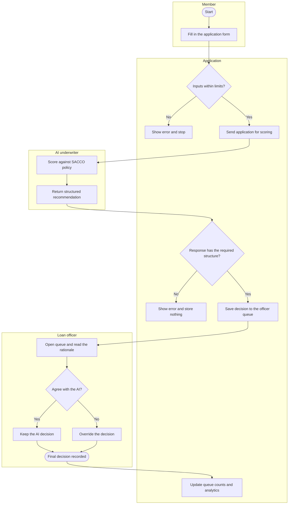
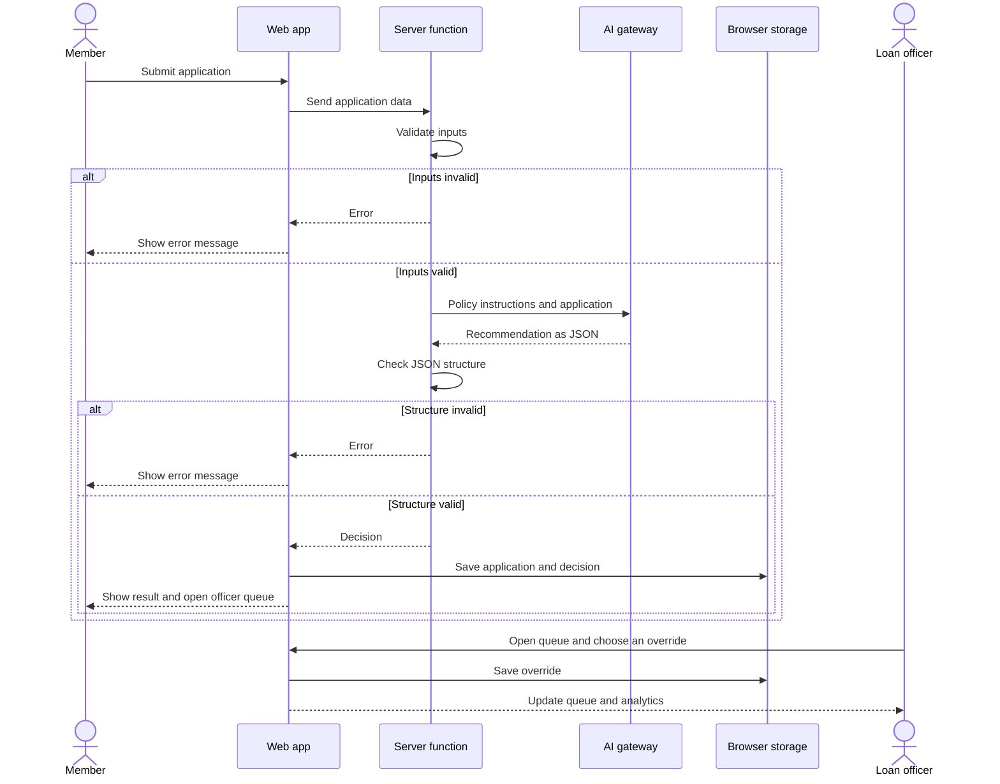

# Ujima Loan Desk: Process Flows

Two views of the same journey. The first shows who does what. The second shows how the parts of the system talk to each other.

The first diagram is a swimlane flow in the style of BPMN, drawn in Mermaid. It is not a formal BPMN 2.0 file. The second is a UML sequence diagram.

## 1. Application to final decision (swimlanes)

## 2. System interaction (sequence)

## 3. Notes for the next release (to-be)

- **B-01:** the last step in the swimlane should update the disbursed by purpose chart from approved loans only. Today it also counts rejected ones.
- **B-02:** when the officer overrides, the flow should ask for a short reason and store it next to the override, so the audit trail explains why a person disagreed with the AI.
